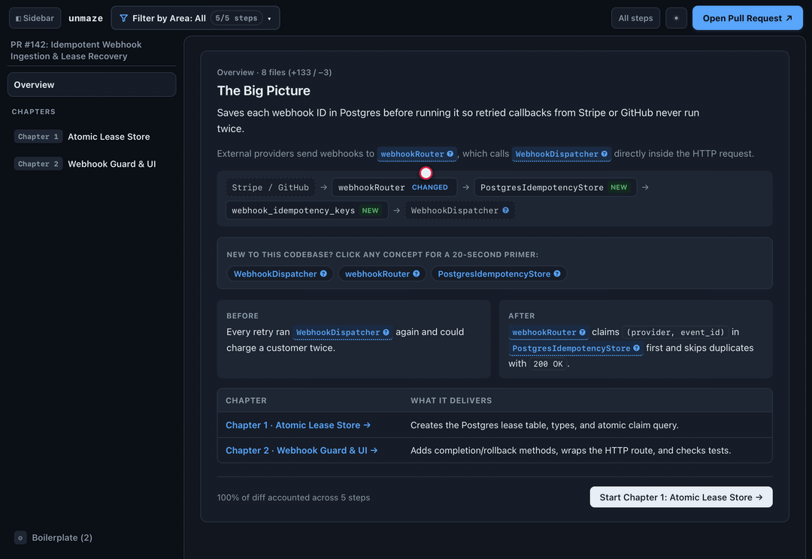
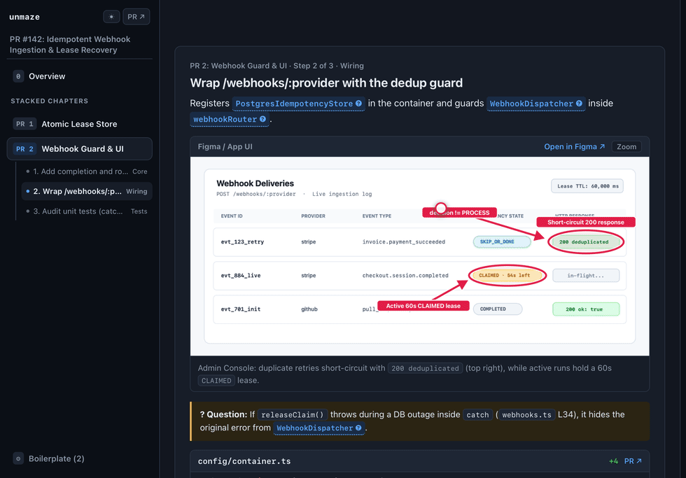

# unmaze — Bringing Human Code Review Back to Life in the AI Era

AI agents can now generate a 1,500-line pull request across 25 files in two minutes. Nobody wrote that code by hand, half the team no longer knows how that subsystem fits together globally, and **real code review is quietly dying**—turning into either an hour of mental exhaustion or a blind *"LGTM"*.

`unmaze` is a Claude Code skill that turns sprawling PR diffs into a **calm, step-by-step interactive review guide**—published as a shareable Artifact you can review yourself or drop straight into a PR description for your team.



---

## Why GitHub Diffs Break Your Brain in the AI Era

GitHub still dumps changed files in **alphabetical order (`A → Z`)**:

| What You Open | Reading Order | What Happens to Your Brain |
| :--- | :--- | :--- |
| **Raw GitHub Diff (`A → Z`)** | `__tests__/` → `api/routes.ts` → `pnpm-lock.yaml` → `store.ts` → `types.ts` | You read mocked tests and route glue *before* seeing the data types or business rules they use. |
| **`unmaze` Guide** | `Overview` → `Chapter 1: Storage` → `Chapter 2: Route & UI` → `Boilerplate` | Every concept is introduced before anything depends on it—zero jumping across 15 browser tabs. |

---

## How `unmaze` Makes Large PRs Easy to Understand

1. **Arc-Style Chapters & Role/Area Tree Filter:** Splits multi-part PRs into ordered chapters (`Chapter 1`, `Chapter 2`, ...) in a collapsible Arc sidebar, with a **pronounced top-bar tree filter** (`Frontend`, `Backend & API`, `Database & Contracts` → specific app areas) that dims unrelated chapters and steps so each engineer can review their own slice.
2. **True Timeline File Evolution & Clickable Diff Blocks:** Files grow step by step along the review timeline so future changes never leak early—and inside large functions or new files, hovering tricky code blocks tints them smoothly over red/green/gray lines and clicking opens a side-margin explanation without covering a single character of code.
3. **Click Any Repo Term to Learn It From Scratch:** Don't know what `WebhookDispatcher` does in this project? Click any highlighted concept chip to open a plain-English engineering modal explaining how that part of the codebase works from zero—and jump straight to the lines touching it.
4. **Simple English & Visual Formatting Rotation:** Enforces short, direct sentences and alternates tables, anchored 1-sentence bullets, and warnings instead of walls of AI prose.

---

## Visual Context & Expandable Code



- **Red-marked screenshots—even on backend PRs:** Traces backend, API, and DB changes to the frontend screen they impact and posts screenshots or Figma frames with **red circles, boxes, and arrows** explaining what the code is actually for (enforced at build time).
- **Expand surrounding lines inline:** Click `↑ Show lines above` / `↓ Show lines below` (`Show less`) or `File at this step` without leaving the guide, and click `PR ↗` to jump to that exact line on GitHub to leave a comment.
- **100% of the diff accounted for:** A deterministic Python check verifies every single changed line from `git diff` is included—nothing can be silently skipped or altered by the AI.
- **One-click team sharing:** Publishes directly via Claude Code's `Artifact` tool (`claude.ai/code/artifact/...`) and also saves local `.html` and `.md` copies.

---

## Install

Requires **Python 3.9+** and **git** (plus `gh` CLI when reviewing GitHub PRs by number or URL). Zero external packages needed.

**Option 1 — Inside Claude Code (Plugin Marketplace):**
```text
/plugin marketplace add t10ko/unmaze
/plugin install unmaze
```

**Option 2 — Via `npx skills`:**
```bash
npx skills add t10ko/unmaze --skill unmaze --agent claude-code
```

**Option 3 — Manual symlink (global or per-repo):**
```bash
git clone https://github.com/t10ko/unmaze.git
mkdir -p ~/.claude/skills
ln -s "$(pwd)/unmaze/skills/unmaze" ~/.claude/skills/unmaze
```

---

## Usage

Run `/unmaze` inside any repository in Claude Code:

```text
/unmaze                     # Reviews current branch PR or diff against main
/unmaze 142                 # Reviews GitHub PR #142
/unmaze <github-pr-url>     # Reviews any PR by URL
/unmaze main...HEAD         # Reviews a specific git range
/unmaze --staged            # Reviews staged changes before committing
```

---

## Try the Included Demo Locally

```bash
python3 skills/unmaze/scripts/parse_diff.py \
  --patch examples/sample-hairball.patch \
  --context-dir examples/sample-context \
  --pr-url https://github.com/acme/payments/pull/142 \
  --out-dir .unmaze/demo

python3 skills/unmaze/scripts/build_artifact.py \
  --manifest .unmaze/demo/diff-manifest.json \
  --plan examples/sample-plan.json \
  --out .unmaze/demo/unmaze-review.html

open .unmaze/demo/unmaze-review.html
```

## License

[MIT](LICENSE)
