# unmaze — AI code review guides for big pull requests

### Bringing human code review back to life in the AI era.

**A Claude Code skill that turns any GitHub pull request into a calm, step-by-step code review guide a human can actually follow.**

[](https://github.com/t10ko/unmaze/releases)
[](#install-in-30-seconds)
[](#requirements)
[](LICENSE)

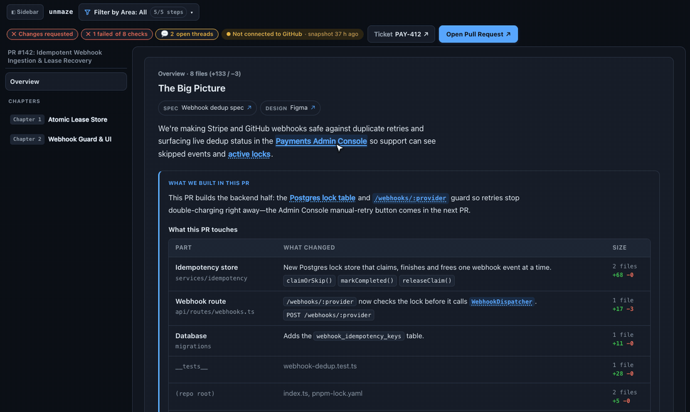

AI agents now write a 1,500-line pull request across 25 files in two minutes. Nobody on the team typed that code, and GitHub shows it to reviewers in alphabetical order. So code review quietly turns into either an hour of tab-juggling or a blind **"LGTM"**.

`unmaze` is a free, open-source [Claude Code](https://claude.com/claude-code) plugin. Run `/unmaze` on a PR and Claude reads the whole diff, works out the order it was built in, and publishes an interactive review guide you can share with your team:

- **The story first:** what the whole task is, what *this* PR does, which services it touches and what has to happen at deploy time.
- **Then the code, in the order it makes sense:** data shapes before logic, logic before wiring, tests next to the code they prove.
- **Plain notes on the hard parts**, the PR's approvals, checks and comments right on the page, and a check that **every changed line** made it into the guide.
- **Proof it works:** when someone ran end-to-end checks on the PR, a "Tested end to end" section shows each one in plain words, with a GIF of every browser step.

It does not replace your reviewers or leave bot comments on your PR. It helps a human understand the change fast enough to review it properly.

---

## Contents

- [Install in 30 seconds](#install-in-30-seconds)
- [Set it up for your whole team](#set-it-up-for-your-whole-team)
- [Why reviewing AI-generated pull requests is hard](#why-reviewing-ai-generated-pull-requests-is-hard)
- [Everything unmaze does, one feature at a time](#everything-unmaze-does-one-feature-at-a-time)
- [How it works](#how-it-works)
- [FAQ](#faq)
- [Try the demo locally](#try-the-demo-locally)

---

## Install in 30 seconds

You need [Claude Code](https://claude.com/claude-code), **Python 3.9+** and **git**. Reviewing GitHub PRs by number or URL also needs the [`gh` CLI](https://cli.github.com/), signed in. No other packages.

**Option 1 — Claude Code plugin marketplace (recommended):**

```text
/plugin marketplace add t10ko/unmaze
/plugin install unmaze
```

**Option 2 — `npx skills`:**

```bash
npx skills add t10ko/unmaze --skill unmaze --agent claude-code
```

**Option 3 — plain Claude skill, symlinked:**

```bash
git clone https://github.com/t10ko/unmaze.git
mkdir -p ~/.claude/skills
ln -s "$(pwd)/unmaze/skills/unmaze" ~/.claude/skills/unmaze
```

Then, inside any repository in Claude Code:

```text
/unmaze                     # the current branch's PR, or its diff against main
/unmaze 142                 # GitHub PR #142
/unmaze <github-pr-url>     # any PR by URL
/unmaze main...HEAD         # any git range
/unmaze --staged            # your staged changes, before you even commit
```

You get a link to a shareable board on claude.ai, plus local `.html` and `.md` copies.

---

## Set it up for your whole team

**For one repository:** commit this to the repository's `.claude/settings.json` (if the file already exists, add these two keys to it):

```json
{
  "extraKnownMarketplaces": {
    "unmaze-marketplace": {
      "source": { "source": "github", "repo": "t10ko/unmaze" },
      "autoUpdate": true
    }
  },
  "enabledPlugins": {
    "unmaze@unmaze-marketplace": true
  }
}
```

When a teammate opens the repository in Claude Code and trusts the folder, Claude Code adds the unmaze marketplace for them. Each teammate then installs unmaze once in their copy of the repository:

```bash
claude plugin install unmaze@unmaze-marketplace --scope project
```

**For the whole company:** an Owner of a Claude for Teams or Enterprise organization can paste the same JSON into **Organization settings → Claude Code → Managed settings** on claude.ai, or ship it through MDM or a `managed-settings.json` file. Claude Code then installs unmaze for everyone at the start of their next session, with no step for each person. See [Manage Claude Code plugins for your organization](https://code.claude.com/docs/en/plugins/org) for the details.

---

## Why reviewing AI-generated pull requests is hard

| What you open | Reading order | What happens to your brain |
| :--- | :--- | :--- |
| **GitHub's "Files changed" tab** | `__tests__/` → `api/routes.ts` → `pnpm-lock.yaml` → `store.ts` → `types.ts` | You read mocked tests and route glue before you've seen the data types or the business rules they depend on. |
| **An unmaze guide** | Overview → Chapter 1: Storage → Chapter 2: Route & UI → Appendix | Every idea shows up before anything that uses it. No jumping between 15 tabs. |

Big PRs were always hard to review. With AI writing the code, they're also bigger, more frequent, and written by "someone" nobody can ask. A good code review still needs a human who understands the change — unmaze is built to get that human there quickly.

---

## Everything unmaze does, one feature at a time

### 1. A PR overview that answers "what is this and what does it touch?"

The guide opens with the whole task in one casual sentence, the spec and Figma links (the ticket sits in the top bar, next to the PR button), and then a **"This PR"** block: what this PR builds, every service, app or package it touches (with new routes and entry points), and its **ship facts** — schema migrations, backfills, config, feature flags, new dependencies, contract changes and deploy order, with "none" said out loud so reviewers don't have to guess.

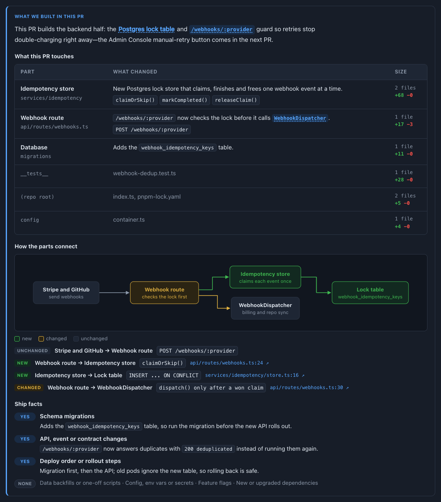

### 2. A diagram only when it actually helps

When the hard part of a PR is how several parts call each other, the overview adds a small **"How the parts connect"** picture, marked like a code diff: new parts in green, changed in amber, removed in red. Every arrow links to the exact line that makes the call. On PRs where a diagram would only repeat the file list, unmaze skips it on purpose.

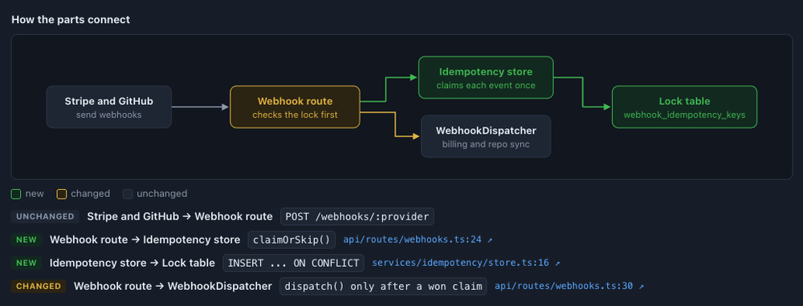

### 3. Short notes right above the tricky code

Every block a newcomer would have to stop and decode gets a numbered note **inside the diff**, right above it: a short title you click to open one sentence on what the block does and why it's written that way. Hover a note to light up its lines (and the other way round). One "Hide notes" button per file when you just want the code.

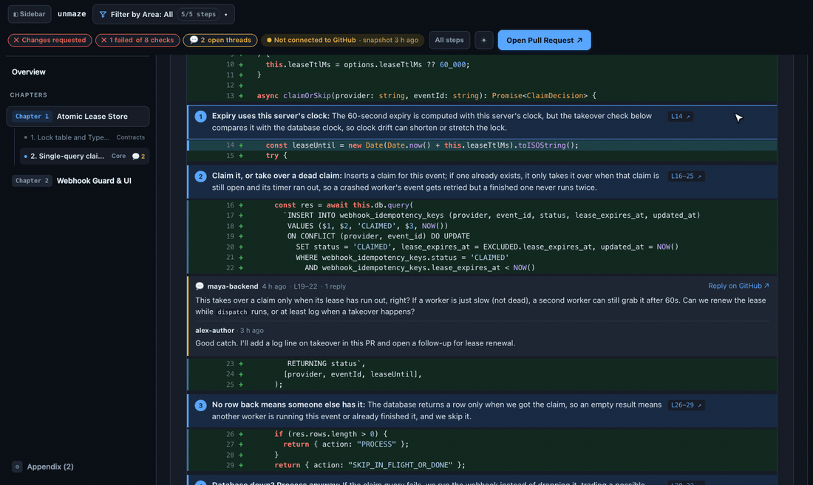

### 4. Files that grow step by step, in build order

Large PRs are split into **chapters and steps** in the order the code was built. Each file is shown **as it exists at that step**: earlier steps are already in it, this step's lines glow green or red, and later steps haven't happened yet — so nothing from the future leaks in. "File at this step" shows the whole file at that moment.

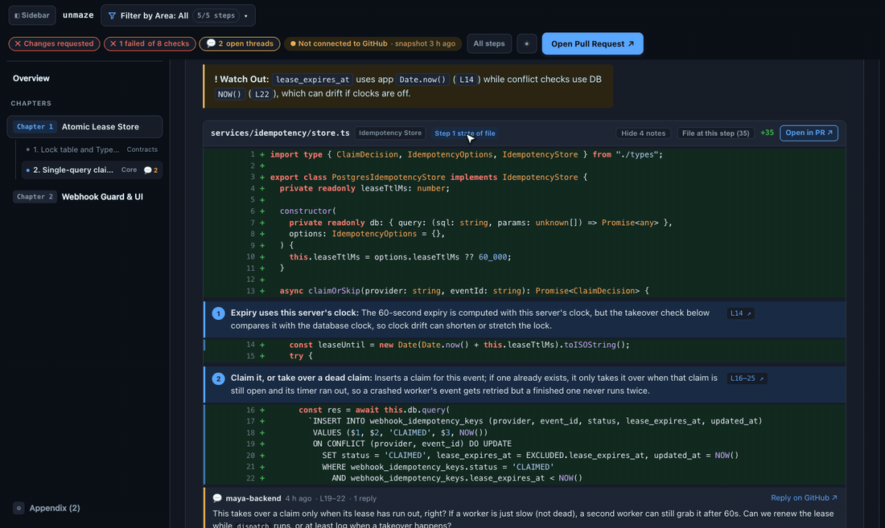

### 5. Click any term you don't know

A second Claude pass finds the words a newcomer would trip on — new names from this task *and* existing parts of your repo — and links them where they're used, even when the sentence says "frees the lock" instead of `releaseClaim()`. Click one for a short, plain explanation.

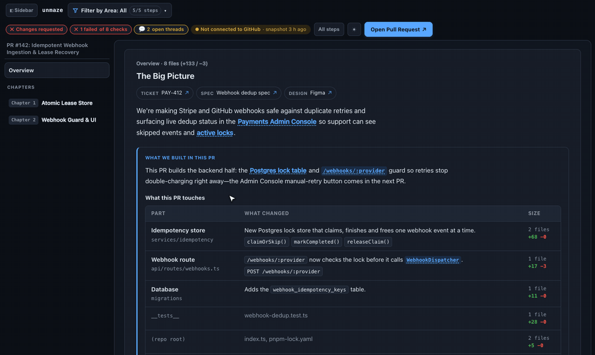

### 6. Review only your part: filter by area

Frontend, backend, database, infra — the top-bar filter dims every chapter and step outside the areas you pick, so each reviewer can take their own slice of a big PR.

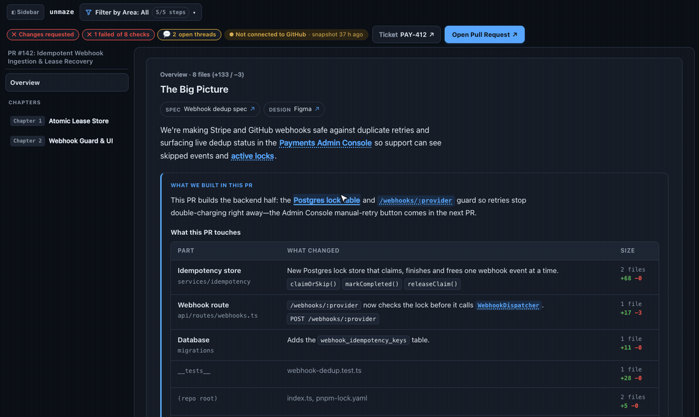

### 7. Approvals, checks and comments from GitHub, right on the guide

The top bar shows the PR's **review state** (approved, changes requested, review required), its **checks** (passed, failed, running) and its **open comment threads**. Comment threads sit right on the lines they're about, and the side panel lists reviewers, every check with a link to its logs, and the whole conversation.

Hover any line and press **+** to comment on it. Viewers who have GitHub connected in claude.ai see live data and post as themselves. Everyone else sees a dated snapshot with a clear **"Not connected to GitHub"** note, and the comment box copies their text and opens that exact line on GitHub.

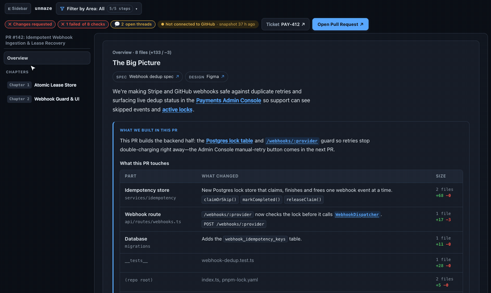

### 8. Screenshots with red marks — even on backend PRs

unmaze traces backend, API and database changes to the screen they affect and attaches screenshots or Figma frames with **red circles, boxes and arrows** showing what the code is for. Three or more screenshots become a gallery; before/after pairs sit side by side.

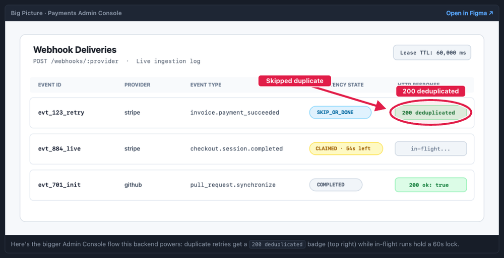

### 9. More context and a one-click jump to the exact line on GitHub

Need more around a change? "Show lines above / below" expands it in place. Every line number and every row's **PR ↗** badge opens GitHub scrolled to that exact line, ready for your comment.

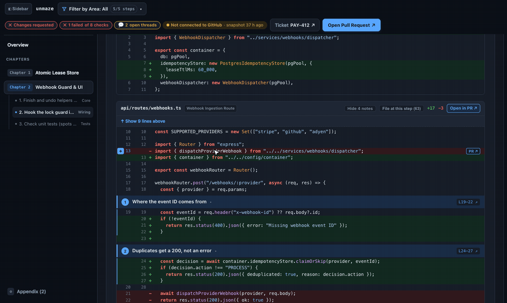

### 10. Every changed line is accounted for

A plain Python check — not the AI — verifies that **every changed line in the diff** lands in exactly one step. Nothing can be silently skipped, and the build fails loudly if anything is missing:

```text
✓ Verified 100% diff coverage (8/8 hunks accounted across 5 steps, 2 red-marked screenshot(s)).
✓ Interactive HTML artifact written to: .unmaze/demo/unmaze-review.html (754,816 bytes)
```

### 11. Guides that stay up to date after every push

Once a guide is published, unmaze remembers it for that branch. After each later `git push`, Claude refreshes it **at the same link** — carrying your walkthrough over to the new diff and refreshing approvals, checks and comments — without anyone typing `/unmaze` again. `board_registry.py pause` turns it off.

### 12. Calm to read, even on a phone

Fewer, fuller steps (about one per 150 lines of production code, 5–12 in total), roomy text at ~75 characters a line, a dark theme, and a layout that works on a phone: notes and comments stay readable while the code scrolls sideways.

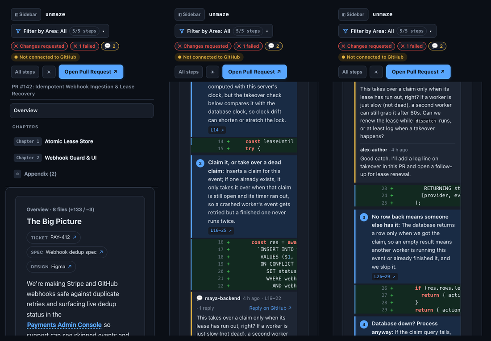

---

## How it works

1. **Parse.** A Python script reads the PR (via `gh`), a git range, staged changes or a `.patch` file, and splits it into numbered pieces with full-file context. For a GitHub PR it also saves the current approvals, checks and comment threads.
2. **Plan.** Claude writes a plan: the overview, chapters and steps in build order, notes on tricky blocks, and red-marked screenshots of the screens the change affects.
3. **Explain.** A second, cold-reader pass finds unfamiliar terms and writes short explanations grounded in your repo.
4. **Verify and build.** A deterministic check confirms 100% of changed lines are covered, then one self-contained HTML page (plus a Markdown copy) is built — no server, no external scripts.
5. **Publish.** Claude publishes it as a private claude.ai artifact you can share, and keeps it fresh after each push.

---

## FAQ

### How do I review a large pull request?

Read it in the order it was built, not alphabetically: start with what the PR is for and what it touches, then data shapes, then the core logic, then the wiring, then the tests. unmaze does that ordering for you and adds short notes on the hard parts. Run `/unmaze <pr-url>` in Claude Code.

### How should I code review AI-generated code?

Assume nobody fully understood it yet — including the person who opened the PR. Check the whole task, the ship facts (migrations, flags, deploy order) and how the parts call each other before you judge single lines. unmaze puts exactly that on the first page and makes sure no changed line is skipped.

### Is this an AI code review bot like GitHub Copilot code review or Codex review?

No. Review bots read the diff and leave comments. unmaze helps a **human** read and understand the PR, then leave better comments themselves. They work well together: bot comments on the PR show up on the guide like any other comment.

### Does it work outside GitHub?

Yes for the guide itself: any git range, staged changes or `.patch` file works, and line links can point at GitLab merge requests too. The approvals, checks and comments panel is GitHub-only.

### How do reviewers get live GitHub data and comment from the guide?

Each reviewer adds GitHub's own MCP server (`https://api.githubcopilot.com/mcp/`) as a claude.ai connector named **GitHub** (claude.ai → Settings → Connectors → Add custom connector), then reloads the guide and presses **Connect to GitHub**. Your token never reaches the page; claude.ai makes the calls as you. This setup is new and hasn't been tested end to end with a real connector yet — without it, the guide still shows the saved snapshot and the copy-and-open comment box.

### Where does my code go?

The diff is read locally by Claude Code, the same way Claude Code reads your repo for any other task. The guide is published as a **private** claude.ai artifact that only you can open until you share it, and local HTML and Markdown copies stay on your machine, inside the repo's `.git` folder.

### Is it free?

Yes — unmaze is MIT licensed. You need access to Claude Code to run it.

---

## Try the demo locally

```bash
python3 skills/unmaze/scripts/parse_diff.py \
  --patch examples/sample-hairball.patch \
  --context-dir examples/sample-context \
  --pr-url https://github.com/acme/payments/pull/142 \
  --out-dir .unmaze/demo

python3 skills/unmaze/scripts/build_artifact.py \
  --manifest .unmaze/demo/diff-manifest.json \
  --plan examples/sample-plan.json \
  --activity examples/sample-activity.json \
  --out .unmaze/demo/unmaze-review.html

open .unmaze/demo/unmaze-review.html
```

The screenshots and GIFs in this README are captured from that demo with `node tools/capture-readme-media.mjs <board-url> assets` (headless Chrome, ffmpeg and ImageMagick; no npm packages).

## Requirements

- [Claude Code](https://claude.com/claude-code)
- Python 3.9 or newer and git
- The [`gh` CLI](https://cli.github.com/), signed in, for GitHub PRs by number or URL

## Contributing

Issues and pull requests are welcome. Run the tests with:

```bash
python3 -m unittest tests.test_unmaze
```

## License

[MIT](LICENSE)
